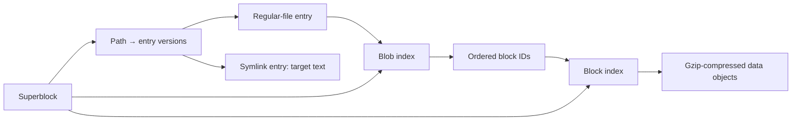

# erwtensoep technical manual

[README](../README.md) · [User manual](user-manual.md)

This document describes the current repository and archive format. Source links
are relative to this manual so they work in a checkout and on repository hosts.
For command syntax and everyday workflows, use the user manual.

## Contents

- [Repository map](#repository-map)
- [Program initialization](#program-initialization)
- [Archive model and format](#archive-model-and-format)
- [Storage abstraction](#storage-abstraction)
- [Merge pipeline](#merge-pipeline)
- [Reading, browsing, and restoring](#reading-browsing-and-restoring)
- [Removal and reference tracking](#removal-and-reference-tracking)
- [Statistics](#statistics)
- [Verification, fsck, and rebuild](#verification-fsck-and-rebuild)
- [Consistency and implementation limits](#consistency-and-implementation-limits)
- [Development and testing](#development-and-testing)

## Repository map

The Go module is `josvisser.nl/erwtensoep`. It builds one executable from `cmd`;
there is no server process or external database.

```text
erwtensoep/
├── cmd/                 Executable, command handlers, interactive shell, tests
├── internal/
│   ├── fs/              Archive model, operations, validation, tests
│   ├── storage/         Object-storage interface and backends, tests
│   ├── testutil/s3test/  Local S3 HTTP fixture shared by tests
│   └── utils/           Stopwatch/output helper
├── docs/                User and technical manuals
├── bin/                 Local build output; ignored by Git
├── erwtensoep.json      Example configuration
├── erwtensoep-s3.json   Example S3 configuration, without credentials
├── go.mod, go.sum       Module definition and dependency checksums
├── Makefile             Build, test, and vet targets
├── README.md            Project entry point and feature overview
└── LICENSE              Apache License 2.0
```

| Source area | Responsibilities |
| --- | --- |
| [`cmd/main.go`](../cmd/main.go), [`config.go`](../cmd/config.go), [`flags.go`](../cmd/flags.go) | Root Cobra command, home configuration, shared options, backend selection, exit status. |
| `cmd/merge.go`, `list.go`, `remove.go`, `restore.go`, `verify.go`, `rebuild.go`, `stats.go`, `fsck.go` | Top-level command arguments, output, and confirmation behavior. |
| [`cmd/cli.go`](../cmd/cli.go), [`cli_fs.go`](../cmd/cli_fs.go) | Shell loop, tokenizer/globbing, virtual directory tree, archive path resolution. |
| `cmd/cli_commands.go`, `cli_versions.go`, `cli_display.go`, `cli_rm.go`, `version_selection.go`, `remove_versions.go` | Navigation/listing/usage, saved-version tables, streaming display/pager, and shared single/multiple version-selection prompts. |
| [`cmd/cli_input.go`](../cmd/cli_input.go), [`cli_history.go`](../cmd/cli_history.go) | Terminal editor, completion, persistent history. |
| [`internal/fs/superblock.go`](../internal/fs/superblock.go), `options.go`, `storage.go` | Index lifecycle, serialization, options, default backend. |
| `internal/fs/block.go`, `blob.go`, `regularfile.go`, `symlink.go`, `filestats.go` | Object types, IDs, source metadata, file ingestion. |
| `internal/fs/merge.go`, `read.go`, `restore.go`, `remove.go`, `stats.go` | Archive operations. |
| `internal/fs/merge_tar.go` | Tar/gzip source validation, exclusion discovery, metadata conversion, hard-link resolution, and streamed member import. |
| [`internal/fs/fsck.go`](../internal/fs/fsck.go), [`fsck_objects.go`](../internal/fs/fsck_objects.go) | Inspection, validation, repair planning, and repair execution. |
| `internal/fs/verify.go`, `rebuild.go` | Earlier presence/gzip verifier and separate index reconstruction. |
| [`internal/storage/backend.go`](../internal/storage/backend.go), `local.go`, [`s3.go`](../internal/storage/s3.go), `memory.go`, `path.go`, `inventory.go` | Object operations, local/S3 fan-out mapping, memory backend, key validation, inventory/pruning. |

Direct dependencies declared in [go.mod](../go.mod) are Cobra and pflag for
commands/options, `go-humanize` for formatted sizes, and `golang.org/x/term` for
terminal editing and paging. AWS SDK for Go v2 supplies the S3 client, endpoint
resolution, signing, and retries; Smithy supplies API/HTTP error types. `x/sys`,
`mousetrap`, and SDK support modules are indirect dependencies. Gzip, JSON,
hashing, filesystem access, and concurrency primitives come from the Go standard
library. The module declares Go 1.23.2; the selected SDK versions preserve that
requirement. Exact dependency versions are recorded in the module files.

## Program initialization

Package `main` registers commands through `init` functions. Cobra's root
`PersistentPreRunE` performs three steps before ordinary command execution:

1. Load `~/.erwtensoep.json` and apply top-level settings, then the selected
   command section. Flags explicitly set by the user retain precedence.
2. Require an archive location, except for `hello` and `recipe`, which skip
   storage initialization. Local archive commands offer to create a missing
   directory; `fsck` returns an error. S3 locations are parsed without host
   filesystem operations or bucket-creation prompts.
3. Select storage. The default `auto` selects S3 for an `s3://bucket/prefix`
   URL and local storage for host paths. S3 URLs also override the old `local`
   configuration value. Explicit `s3` requires a URL; `memory` rejects S3 URLs
   and creates a fresh in-memory store. S3 construction validates the endpoint
   and environment credentials before sending requests.

Configuration uses pointer fields to distinguish an omitted value from zero or
false. `setIfNotChanged` checks whether a flag exists and was explicitly set,
then updates its value without marking it as a command-line override. This
allows a command section to override the general configuration. Fsck's repair
and verbosity flags are local command variables, not configuration fields.
S3 settings are `endpoint_url` and `region`. Global flag normalization aliases
`--endpoint_url` to `--endpoint-url`, preserving explicit-flag precedence.

Archive methods receive [`fs.Options`](../internal/fs/options.go). Most commands
load the index with `GetSuperblock`. Fsck and rebuild take independent paths to
avoid requiring a healthy loaded index. All three use `ensureStorage`, which
preserves S3 URLs and only applies `filepath.Abs` to local locations. This also
supports direct filesystem-package callers supplying an S3 location, endpoint,
and region without an injected backend. `main` exits with status 1 when Cobra
returns an error. Individual merge failures can be accumulated as reported
counts, and the interactive shell catches command errors and keeps running;
neither necessarily produces a failing process exit.

## Archive model and format

### Entries, blobs, and blocks



An **entry** describes a version of a path. A regular-file entry references a
**blob**, which describes complete file content as an ordered sequence of
**blocks**. Multiple entries can reference one blob. Different blobs can
reference the same block, and one blob can repeat a block ID.

Symlink entries contain target text and metadata; they do not reference blobs.
Directories have no stored entries. The CLI synthesizes directories from path
prefixes, which is why empty source directories cannot be reconstructed.

`Entry` is an internal interface implemented by `RegularFile` and `Symlink`.
It exposes metadata and path accessors plus private marker and hash methods.

### Superblock

`superblock.json.gz` is a gzip-compressed JSON index containing:

| JSON field | Representation |
| --- | --- |
| `version` | Format version, currently `0`. |
| `generation` | Index generation, incremented by `Write` before serialization. |
| `last_update` | Time serialized by Go's JSON time encoder. |
| `entries` | Map from relative path to a map of entry ID → entry record. |
| `blobs` | Map of blob ID → blob descriptor. |
| `blocks` | Map of block ID → `{ "id": "...", "size": N }`. |

The superblock contains enough metadata to navigate entries and locate data
blocks without reading every descriptor. Separately stored blob and entry
records allow reconstruction when the index is missing or damaged.

`GetSuperblock` reads the whole index into memory. A missing index produces a
new empty in-memory superblock; it does not automatically discover existing
object files. The `fix` method converts generic decoded entry maps to concrete
types, parses size caches, and reconstructs each block's in-memory blob back
pointers. Missing block metadata produces an error. Some malformed metadata
can panic in this normal loader; fsck uses separate checked parsers.

### Record schemas

A regular-file entry contains `path`, `blob_id`, and the flattened `FileStats`
fields `owner`, `group`, `size`, `mode`, and `mtime`. A symlink replaces `blob_id`
with `target`. There is no separate JSON type discriminator: these fields
identify the concrete type.

For directory sources, owner/group are names looked up from source UID/GID.
Tar sources use header `Uname`/`Gname`, falling back to decimal UID/GID strings.
File and blob sizes are decimal strings to avoid JSON number precision loss.
`mode` is the numeric Go `fs.FileMode`, including type bits; `mtime` is a time
string. Private parsed-size caches are not serialized.

A blob descriptor contains `id`, `size`, and `blocks`, where `blocks` is an
ordered array of block IDs. A block's original byte length is a `uint32`, with
the merge buffer size defined as `BlockSize = 1024 * 1024` bytes (1 MiB).
Ingestion reads chunks up to that size; the final chunk can be smaller. This is
fixed-size-buffer chunking, not content-defined chunking.

### IDs and version identity

All IDs are 16-character lowercase hexadecimal CRC64 values using the ECMA
polynomial. The inputs are:

| ID | Bytes hashed, in order |
| --- | --- |
| Block | Original uncompressed block contents. |
| Blob | Concatenated ASCII block IDs, preserving order and repetitions. |
| Regular-file entry | `regularfile`, relative path, then the metadata representation below. |
| Symlink entry | `symlink`, relative path, metadata representation, then target text. |

The metadata hash input concatenates owner, group, and decimal size strings,
then little-endian `uint32` mode and little-endian `uint32(mtime.Unix())`.
Strings are not length-prefixed. Stored times can have nanoseconds, but the
hash uses seconds and truncates the Unix time to 32 bits.

The regular-file entry hash intentionally excludes `blob_id`. Merge can decide
that a version already exists from metadata alone, without reading its content.
This also means content changes with identical hashed metadata are missed, and
changes within one timestamp second can collide at the entry-identity level.

Block sharing assumes equal CRC64 IDs identify equal data; there is no
secondary cryptographic digest or content comparison on an existing ID. CRC64
is a checksum, not an authentication or collision-resistant security mechanism.
Reordering blocks changes a blob ID; repeating a block adds another occurrence
to the sequence. An empty file has an empty block list and a zero CRC64 blob ID.

### Physical layout and gzip encoding

Filesystem code passes canonical keys such as `blocks/0123456789abcdef` to
storage. The local backend maps that key to:

```text
ARCHIVE/
├── superblock.json.gz
├── superblock.json.gz.bak          Optional previous normal index
├── superblock.json.gz.fsck.bak     Optional pre-repair index
├── rebuilt_superblock.json         Optional reconstructed index, gzip encoded
├── blocks/0123/4567/89ab/cdef
├── blobs/<4 hex>/<4 hex>/<4 hex>/<4 hex>
└── entries/<4 hex>/<4 hex>/<4 hex>/<4 hex>
```

The last four-character component is a **file**, with three directory levels
between it and the category directory. Object files have no `.gz` suffix but
are gzip-compressed. Block payloads are raw bytes; blob and entry payloads are
JSON. `dataWrite` places the uncompressed payload length as four little-endian
bytes in the gzip `Extra` field. Fsck expects exactly those four bytes and
checks the decoded length against them. The superblock uses a separate gzip
JSON writer and does not use this custom field.

Gzip trailers provide their own checksum and length check, separate from
erwtensoep's CRC64 object names. The data is compressed, not encrypted.

## Storage abstraction

[`storage.Backend`](../internal/storage/backend.go) defines four operations:

```go
GetBlob(key string) (io.ReadCloser, error)
PutBlob(key string, data []byte) error
DeleteBlob(key string) error
ListBlobs(prefix string, fn func(key string) error) error
```

Here “blob” means any backend object, including entries, blocks, and indexes;
it is broader than an archive `fs.Blob`. Callers own and must close returned
readers. Keys are backend-relative; storage handles physical fan-out.

`LocalBackend` validates relative keys, creates directories with mode `0700`,
and writes objects using a temporary file in the destination directory. It
writes, syncs, and closes that file, then renames it into place. Temporary files
use mode `0600`. This avoids truncating an old index on a failed replacement.
The parent directory is not explicitly synced, and multiple object writes do
not form one transaction.

`DeleteBlob` removes the object and calls `pruneParents` for block, blob, and
entry paths. The latter uses `rmdir` from the leaf toward the archive root,
stopping at a nonempty directory. Empty category roots can disappear; the
archive root remains. Later writes recreate needed directories.

`ListBlobs` maps recognized fan-out paths back to canonical keys and sorts
them before callbacks. Ordinary enumeration hides misplaced physical objects.
The optional `ArchiveInspector` interface adds full layout inventory, removal
of invalid physical objects, and empty-directory pruning. Local inventory
uses `Lstat`, does not follow symlinks, and records wholly empty directory
trees in child-before-parent order. Backends without that interface fall back
to enumerating canonical objects for fsck, with no physical-layout repair.

`storage.BlobSize` uses an optional `BlobSize(string) (int64, error)` method.
Local storage uses `Stat`; S3 uses `HeadObject`; memory storage reports buffer length. Other backends
fall back to reading and counting the object bytes, then closing the reader.

`MemoryBackend` is an in-process, mutex-protected object store used by tests and
development. It does not persist across executable invocations. Its thread
safety does not make a `Superblock` safe for concurrent mutation.

### S3-compatible storage

[`S3Backend`](../internal/storage/s3.go) implements both `Backend` and
`ArchiveInspector`, plus the optional `BlobSize` method. It does not depend on
AWS-specific account discovery. The constructor accepts the archive URI,
provider endpoint, and signing region, then constructs an SDK client directly.

The URI parser separates the bucket from a URL-decoded prefix. A single
trailing slash is accepted; ambiguous empty/dot components, URL credentials,
queries, fragments, backslashes, and control characters are rejected. The
backend retains either an empty prefix or one ending in `/`. Every request is
scoped to that exact prefix boundary, so `work/` never includes `work-old/`.
Normal object keys reject absolute and traversal paths before any request.

The S3 physical layout matches local storage. For example:

```text
Archive:       s3://bucket/backups/work
Canonical key: blocks/0123456789abcdef
S3 object key: backups/work/blocks/0123/4567/89ab/cdef
Index key:     backups/work/superblock.json.gz
```

Object bytes and JSON/gzip schemas are unchanged. Copying all archive files
with their relative paths preserved therefore preserves the format between
local storage and an S3 prefix; there is no built-in migration command. Make
such copies while the archive is idle.

The SDK uses an explicit `BaseEndpoint` and `UsePathStyle: true`, keeping the
bucket in the request path rather than adding it to a custom hostname. A
provider-specific endpoint and signing region are independent settings. This
uses the SDK's supported endpoint customization API.
[AWS SDK endpoint configuration](https://docs.aws.amazon.com/sdk-for-go/v2/developer-guide/configure-endpoints.html)

Credentials are captured from `AWS_ACCESS_KEY_ID`, `AWS_SECRET_ACCESS_KEY`,
and optional `AWS_SESSION_TOKEN` during construction and exposed through a
cached credentials provider. The normal SDK profile/instance-metadata discovery
chain is not loaded. Both access and secret keys are required. They remain
private runtime client state; neither `Options` nor the superblock serializes
them. Environment changes require a new process/client; expiring session
credentials are not automatically refreshed. Signing-region precedence is
explicit/configured region, `AWS_REGION`, `AWS_DEFAULT_REGION`, then `us-east-1`.

The endpoint is mandatory even for AWS, and accepts HTTP(S) origins without
userinfo, a bucket/path, query, or fragment. HTTP supports local test servers;
hosted-provider examples use HTTPS. The HTTP client has a two-minute timeout
per attempt and refuses redirects. SDK retry attempts are capped at three.
Requests use Signature Version 4. Optional request/response checksums are set
to `WhenRequired` to avoid automatically requiring checksum trailers and
`aws-chunked` transfers from third-party services; archive gzip and CRC64
validation remains in the filesystem layer.

| Backend method | S3 operation and behavior |
| --- | --- |
| `GetBlob` | `GetObject`; return the streaming response body for the caller to close. |
| `PutBlob` | `PutObject` with a seekable byte reader and known content length. No multipart upload or separate temporary object. |
| `DeleteBlob` | `DeleteObject` for the current object; absence is idempotent. |
| `BlobSize` | `HeadObject` and validate the returned content length. |
| `ListBlobs` | `ListObjectsV2` with prefix and continuation tokens, then map valid fan-out paths to canonical keys and sort. |

List results are checked against the requested prefix before use. Truncated
responses must provide a nonempty, previously unseen continuation token;
otherwise the operation fails rather than returning a partial inventory that
fsck might mistake for missing data. All pages are consumed before ordinary
listing callbacks run. The implementation uses the standard API's pagination
contract. [ListObjectsV2](https://docs.aws.amazon.com/AmazonS3/latest/API/API_ListObjectsV2.html)

Missing-object responses become `os.PathError` wrapping `os.ErrNotExist`,
preserving normal empty-archive and missing-block behavior. Explicit
`NoSuchBucket` errors remain operational errors. Access denied, signing,
transport, and listing failures propagate; they must not turn into corruption
deletions. A bare 404 object/HEAD response maps to a missing object; HEAD errors
can omit the detailed service error code.
[HeadObject error behavior](https://docs.aws.amazon.com/AmazonS3/latest/API/API_HeadObject.html)

Inspection lists the reserved `blocks/`, `blobs/`, and `entries/` categories,
reporting invalid physical keys, including folder markers. Repair deletes exact
invalid keys without path-cleaning them into different objects. S3 has no real
directories, so `EmptyDirs` stays empty and `PruneEmptyArchiveDirs` is a no-op.
Bucket/prefix creation, provider policy management, and deleting historical S3
object version IDs are outside the backend. `stats` measures current referenced
objects, not noncurrent versions retained by a provider.

The implementation targets general-purpose S3 buckets and compatible providers
with path-style access and the operations above. S3 Express directory buckets,
access-point routing, and provider-specific authentication modes are not part
of this backend. It retains the existing single-writer archive model: individual
object replacement does not make index and data updates transactional.

## Merge pipeline

The command loads the superblock and calls `Merge` for each source argument.
`Merge` stats the source: directories use the recursive walker; regular files
with case-insensitive `.tar`, `.tar.gz`, or `.tgz` suffixes use the tar importer.
Other standalone files are rejected. An explicit tar source prints a `WARNING`
on stderr explaining that its members, rather than the container, will be
archived. Detection occurs only at the source boundary: the directory walker
and tar importer do not recursively expand tar files they encounter. The
command defers its final index write when there are reported changes, preserving
completed entries even when a later source returns an error. The recursive walker:

1. Resolves the source root to an absolute host path and checks for archive
   directories to skip.
2. Reads `.erwtensoep` patterns in each directory, inheriting parent patterns.
   `path.Match` applies patterns to each child basename.
3. Recurses into directories, captures symlinks without following them, and
   skips sockets, named pipes, and device files.
4. Computes a relative path and `FileStats`. Regular files outside inclusive
   size limits are skipped.
5. Calculates the entry hash. An existing hash skips the regular-file content
   read; otherwise the file is read through a reusable 1 MiB buffer.
6. Hashes each chunk, reuses known blocks, and writes missing compressed blocks.
   It hashes the ordered block IDs into a blob ID, writes the blob descriptor,
   then writes the entry record and updates the in-memory index.

Both source kinds share `mergeRegularEntry` and `mergeSymlinkEntry` for metadata
version checks and entry writes. `blobifyReader` reads an `io.Reader` with
`io.ReadFull`, giving fixed 1 MiB block boundaries plus a final partial block.
This makes blob IDs independent of gzip/tar reader chunk sizes and preserves
sharing with directory imports. The total payload length must match the saved
file size before a blob descriptor is accepted. File contents remain streamed;
only block buffers and metadata are held in memory.

### Tar sources

`mergeTar` opens a local source once and seeks it back to the start for two
passes. `readTar` wraps `.tar.gz`/`.tgz` input in `gzip.Reader`, then uses
`archive/tar.Reader` for headers and member payloads. Every payload is consumed,
including skipped members, and the decompressed stream is drained past tar EOF
to validate the gzip trailer. The reader checks the merge cancellation flag.

The first pass retains member headers and reads regular `.erwtensoep` payloads
into a directory-to-pattern map. Names are normalized with POSIX path rules;
absolute names, NULs, and any `..` component are rejected. A `.` directory
header is accepted but does not become an entry. Symlink target text is retained
without host filesystem resolution. No member is ever extracted to a host path.

Hard links bind to the most recent preceding target with that name, or the
first subsequent one if the target has not yet appeared. Chains are resolved to
regular members; missing targets, cycles, and targets of other types are errors
for included links. After the full stream validates, inherited exclusion rules
are evaluated independently of header order. The last regular `.erwtensoep`
member at a directory determines its rules. Needed payloads include data for
included hard links whose target path is excluded. Already-saved aliases do not
cause excluded target data to be written unnecessarily.

The second pass checks that headers still match the first pass and streams
needed regular members into the ordinary block/blob pipeline. Tar metadata uses
header permissions, mtime, and owner/group names (or numeric strings). Symlink
size is the target-text length. Hard links are written after their payloads are
available, as regular entries using the link header's metadata and target's
logical size and blob ID. The backend requires no tar-specific changes.
Directories are implicit; unsupported special members are skipped with a warning.

Preflight validation avoids importing a tar already damaged at the start, but
does not make the operation transactional or snapshot a changing source. Backend
errors, interruption, or source changes during import can leave partial results
and unreferenced objects, just as a directory merge can. Headers, exclusion-file
contents, and hard-link relationships consume memory proportional to the input
metadata. Tar payloads are read twice, and gzip inputs are decompressed twice.

### Checkpoints and interruption

The buffer pool has a mutex, but the archive maps themselves are not protected
for simultaneous merge operations. On-disk block existence checks do not
rehash existing contents. `fsck` is the path for full content validation.

`dataWrite` tracks uncompressed bytes written for objects, including descriptor
JSON. `maybeWrite` checks the threshold after directory-source regular files and
tar members, including completed hard links. The
default CLI threshold is 1,000,000,000 bytes, not 1 GiB. `Write` increments the
generation, sets the time, gzip-encodes the index, and resets the threshold
counter after success. If the index was loaded from disk, it attempts a
best-effort backup to `<index-name>.bak`; backup errors on this normal path
are not propagated.

Dry-run mode changes in-memory working state but suppresses object/index
writes. SIGINT/SIGTERM sets an atomic cancellation flag checked by directory,
file, and tar-read loops. Each `Merge` unregisters its signal channel and stops
its signal-waiting goroutine on return. This is cooperative stopping, not a rollback of the merge.
Objects written before an interruption or index-write failure can be absent
from the saved index, which fsck can detect.

## Reading, browsing, and restoring

[`OpenRegularFile`](../internal/fs/read.go) returns an `io.ReadCloser` that walks
a blob's block sequence. It opens only one compressed block at a time, reads
through gzip, closes it at EOF, and advances to the next block. Early `Close`
releases the current block. This bounds open file descriptors and avoids
loading a whole archived file in memory. Fully consumed blocks receive gzip
validation, but this reader does not recompute CRC64 IDs as fsck does.

The CLI builds an `archiveTree` snapshot from the latest entry per path. Equal
modification times are broken deterministically by entry ID. It
synthesizes parent directories while retaining any file entry at the same path.
Bare lookup keys prefer file entries; slash-suffixed keys select directories,
and bare directory aliases exist where there is no file. Each parent has both
children when a collision exists. Traversal and directory-only operations use
the directory node; final bare file operands use the entry node. Top-level listing and
restore use the same time/ID ordering, including zero and negative timestamps.
Both top-level and interactive `ls` append `(N versions)` when a displayed
entry's path has multiple saved versions. Interactive listings use the exact
entry path to count versions, including a symlink's own history, and omit the
suffix for inferred directories. The suffix does not affect sorting.

`cmd/version_selection.go` implements the single-version chooser used by `cat`,
`more`, `du`, explicit-file `ls`, and top-level `restore`. It reuses the numbered
table with removal. `versionSelector` caches a choice (or skip) by exact index
path for one command, including repeated operands and symlink aliases. It never
changes the index or the default browsing tree. `--latest` bypasses prompts;
otherwise single-version paths are automatic and multiple versions require one
number. Invalid answers retry. Empty input skips, while `q`, unanswered EOF, or
an I/O failure aborts collection before any operation output or restoration.
The chooser uses the shell's shared buffered reader in cooked mode, so answers
are separate from command history and pager keys.

File-command resolution accepts a selection callback before following a link,
so older link targets and file-to-link type changes remain accessible. Targets
stay inside the virtual archive and have independent choices when versioned.
Selection happens after choosing the file or directory object. An explicit
trailing slash never selects historical file versions at the directory path.
Navigation and completion retain the latest-version tree.
`du` builds a temporary selected tree, recursively including hidden files and
excluding skipped entries, before printing sizes. Display-depth limits do not
limit selection because deeper files contribute to totals. Directory listings
stay prompt-free; top-level pattern listings also show newest-version metadata.
CLI globs expand before command dispatch, so matching files become explicit
operands and receive the same selection as individually named files. Top-level
`ls` instead retains pattern arguments and only prompts for exact file operands.
Archive-wide statistics and integrity operations always include all versions.

[`versions FILE`](../cmd/cli_versions.go) resolves the operand against the
current archive directory, then reads all entries for that exact path from
`Superblock.Entries`. It sorts a separate slice by modification time and entry
ID, both descending, without modifying the index. `-r` reverses this order;
`-h` formats logical sizes. The table includes IDs, RFC3339 timestamps with
nanosecond precision when present, sizes, modes, paths, and symlink targets.
Final symlinks retain their own histories. Bare names expose saved file entries
even when a directory shares the path; explicit directory operands are rejected. Listing uses only index metadata and makes no block/blob reads,
so the same command works with local and S3 archives.

Path resolution walks components rather than blindly cleaning the entire path.
It enforces file-versus-directory checks, handles logical/physical navigation,
resolves absolute symlink targets at archive root, and stops after 40 symlink
expansions. The tokenizer preserves whether glob characters were quoted;
completion reuses partial parsing and quotes inserted path text as needed.
Completion offers both bare file and slash-suffixed directory candidates for
collisions. CLI glob expansion preserves both final operands, but deduplicates
traversal through a shared parent. Listings and usage output mark colliding
directories with `/` even without a classification flag.

`cat` and `more` use `OpenRegularFile`. Cat streams directly when no formatting
is requested; formatting runs over buffered bytes. More processes buffered
line fragments, allowing lines larger than its read buffer. Both input and
output must be terminals to enable paging and interactive editing.

The terminal editor uses `x/term.Terminal`, raw mode only while reading input,
and a shared buffered reader. A wrapper limits the editor's reads to one byte
so it cannot retain pager keys or subsequent commands. History implements the
terminal's newest-first interface over an oldest-first slice. Saves acquire a
nonblocking `flock` on a separate lock file, reread disk history, append pending
commands, trim to 100 entries, and atomically replace the JSON file. Malformed
history is preserved rather than overwritten. Lock/save failures retain pending
commands for a later retry. Piped sessions do not load or save history.

[`RestoreTargets`](../internal/fs/restore.go) expands restore patterns to sorted
index paths through `matchingPaths`, shared with `RemoveTargets`. Exact
non-glob file operands take precedence over descendants; trailing slashes
select descendants only. Bare names without exact entries select descendants.
Other patterns use the shared matcher; overlapping operands are deduplicated.
Unlike `RemoveTargets`, restore rejects selections containing an entry and any
of its descendants before version selection. `validateRestorePaths` checks
every selected path's ancestors against a set, including symlink ancestors;
checking adjacent sorted names alone would miss intervening siblings such as
`a-other` between `a` and `a/child`. `RestoreVersions` repeats this validation
for library callers before writing any output. The command collects one
version ID per path, then calls `RestoreVersions` with exact path/ID pairs.
`RestoreVersions` validates every selection before touching output files, sorts
paths, and writes under the output directory. The library's existing `Restore`
API remains noninteractive and selects newest versions with deterministic ID
tie-breaking. Regular files are rebuilt
by decompressing blocks in order. Existing selected paths are removed first;
parent directories are created as needed. Permissions and timestamps are
reapplied with errors ignored. Symlinks retain their literal targets. Ownership,
ACLs, extended attributes, and original directory metadata are not restored.
Restore uses host filesystem paths and does not reuse the CLI's virtual path
resolver or enforce a symlink-safe output boundary.

## Removal and reference tracking

[`RemoveTargets`](../internal/fs/remove.go) expands top-level patterns to
archive paths. `Remove` passes those paths to `RemovePaths`. Interactive removal
resolves and expands archive paths itself. It keeps separate sets of exact file
operands and recursive directory operands: `rm a` selects the file and
`rm -r a/` selects strict descendants, preserving all versions of `a`. Both
objects can also be selected together in either argument order. Top-level
removal shares restore's `matchingPaths` selection: a bare file or symlink name
selects only that entry, a trailing slash selects strict descendants, and a bare
name falls back to descendants only when no exact entry exists. Globs still
match whole paths without crossing `/`. Removal intentionally omits restore's
ancestor-conflict validation, so `rm a a/` can remove both. `Remove` inherits
these rules through `RemoveTargets`. Both command interfaces build an
exact path-to-version-ID selection and call `RemoveVersions`, so a quoted
literal `*` or `[` in a filename is not interpreted a second time.

`cmd/remove_versions.go` shares the numbered chooser between top-level and
interactive removal. Tables use the same sorting and metadata formatter as
`versions`. The selector accepts individual numbers, inclusive ranges, or all,
validates a complete answer, and deduplicates indices before mapping them to
entry IDs. All choices are collected before mutation. Blank input skips a path;
cancel, unanswered EOF, or an I/O error abandons the pending selection.
`--all-versions` bypasses the chooser; interactive `-f` also bypasses all prompts.
Top-level removal retains its final confirmation. Interactive removal rebuilds
the browsing tree, so removing the newest entry exposes the next saved version.

`RemovePaths` still removes all versions and returns a path count for callers
using the original API. `RemoveVersions` returns a removed-version count;
empty selections and missing IDs/paths are ignored, never interpreted as all.
Both delegate to the same index/garbage-collection implementation.

There are no persistent numeric block reference counts to decrement. Removal
recomputes reachability from all surviving entry versions:

1. Clone the outer entry map and each selected path's version map, remove only
   selected IDs, and drop a path when its last version is gone.
2. Collect referenced blob IDs from surviving regular-file entries.
3. Collect referenced block IDs from those blobs, rejecting missing metadata.
4. Build new blob/block maps and a garbage list of removed entry records and
   unreferenced indexed data objects.
5. Save the new superblock before deleting garbage. If saving fails, restore
   the previous in-memory maps, generation, and timestamp.
6. Rebuild the block-to-blob back pointers, then delete garbage. Report cleanup
   errors even though the new index has already been saved.

This ordering keeps still-indexed data intact when the index write fails.
A later cleanup failure can leave orphaned physical objects; it is not a
rollback of deletion. Fsck detects those objects. Because fsck recovers usable
orphan blobs, leftovers from an interrupted cleanup may appear in `lost+found`.
Storage pruning removes empty physical parent directories after each deletion.

## Statistics

[`Stats`](../internal/fs/stats.go) walks all saved versions and measures four
byte totals:

| Symbol | Meaning |
| --- | --- |
| `L` | Sum of regular-file sizes across all entry versions. |
| `B` | Sum of sizes of distinct referenced blobs. |
| `U` | Sum of uncompressed sizes of distinct referenced blocks. |
| `C` | Sum of stored byte lengths of those compressed block objects. |

Whole-file savings are `L − B`; additional block-sharing savings are `B − U`;
total sharing is `L − U`; compression savings are `U − C`; overall savings are
`L − C`. Their percentages use the relevant stage's input as denominator.
The logical/stored ratio is `L / C` when `C > 0`. Negative savings are displayed
as increases. Metadata and unreferenced objects are excluded from these totals.

Usage records track occurrence count, first referring path, and a cross-file
boolean. Blob usage propagates through every block occurrence, preserving
repeated blocks and references from saved versions. A second distinct path sets
cross-file usage; multiple versions at one path alone do not. This avoids
holding a full set of referring paths for every block.

The method checks referenced metadata and size consistency, but it does not
decompress block data. Local storage uses file-size lookups and S3 uses HEAD
requests rather than content reads.

## Verification, fsck, and rebuild

### Verify

`Verify` starts with a normally loaded superblock. It builds stored-ID sets for
blocks, blobs, and entries; full mode decompresses objects into `io.Discard`,
while shallow mode only enumerates them. It then compares index membership
against stored IDs, reports missing/unindexed/corrupt objects, and returns an
error when issues exist. Ticker-driven progress goes to stderr.

This verifier does not perform fsck's schema, CRC64-name, path, or physical
layout checks. “Unreferenced” here means absent from the corresponding index
map, which is less comprehensive than checking reachability from entries.

### Fsck inspection

`CheckArchive` returns a `CheckReport` without mutating storage. It does not
call the normal loader. The report contains discrepancies, proposed object
counts, recovery/recreation counts, and the private repair state.

The inspection sequence is:

1. Preserve the raw index bytes if present. Decode the superblock with checked
   JSON/gzip readers, retaining usable sections even when others are invalid.
   Missing or corrupt indexes become repairable issues; an unsupported future
   format version is an error rather than a rewrite candidate.
2. Inventory physical storage. Report invalid locations, nonregular objects,
   symlinks, and empty directories through `ArchiveInspector` when available.
3. Read blocks, then blob descriptors, then entry records. Check gzip integrity,
   original-size fields, object names, required metadata, and hashes.
4. Reject blobs with absent/corrupt blocks or inconsistent total lengths.
   Reject entries with absent/unusable blobs or size mismatches.
5. Cross-reference disk objects and index sections. Disk-valid records supply
   corrected metadata. Missing entry records can be recreated from valid index
   metadata, while corrupt physical entry records are not revived this way.
6. Recover valid orphan blobs under `lost+found`, retain referenced blocks,
   identify unused blocks, and assemble the complete replacement index.

`readCheckedObject` tracks raw backend read errors separately from content
errors. Permission/device/close failures abort the scan; they do not turn an
object into a deletion candidate. Checked JSON decoding attempts a second
decode and requires EOF, forcing the gzip reader through its trailer and
rejecting trailing JSON. Block validation limits decompressed reads to one byte
beyond `BlockSize`, calculates CRC64, and checks the filename. Blob validation
hashes the ordered block IDs and validates the declared size against available
blocks. Entry validation checks required fields, file type, a clean relative
path, size, referenced ID, and metadata hash.

Recoveries use the blob hash because an orphan blob has no surviving entry
pathname. A fresh entry hash is calculated from the new path and metadata.
Names use numeric suffixes on collision; a file or symlink occupying
`lost+found` blocks repair before mutation.

The optional progress callback receives `(phase, completed, total)`. Directory
discovery begins with total `-1`; later totals come from the stored inventory,
including corrupt and unindexed objects. Each object-validation phase starts
at zero and advances once per inspected object. The command passes a callback
only with `-v`, throttles display to phase changes/about two seconds, and
formats percentages per phase. Zero-length phases are complete. Reference
reconciliation and repair do not currently have separate percentage callbacks.

### Fsck repair

`CheckReport.Repair` applies the plan after command-layer confirmation or `-y`:

1. Refuse blocked plans and dry-run mode. Re-read the active index and compare
   it byte-for-byte with the snapshot, including its prior absence.
2. Save the original index to `superblock.json.gz.fsck.bak`, if present. Unlike
   the ordinary backup path, a backup failure aborts repair.
3. Remove invalid physical objects through the inspector, checking parent paths
   and avoiding symlink traversal. Write recovered/recreated entry records.
4. Atomically replace the active superblock through the storage backend.
5. Delete scheduled entry, blob, and block objects, in that order, and prune
   empty directories. Return aggregated cleanup errors.

The index is rewritten before valid-layout corrupt/unusable objects are
deleted, but invalid-layout cleanup and new entry writes occur before that
rewrite. Repair is a sequence of operations, not a transaction with rollback.
An index byte comparison detects some concurrent changes; it is not a lock or
a snapshot of all object files. Keep the archive idle and rerun the check after
repair, especially after a failure.

### Rebuild

`RebuildSuperblock` starts with a fresh index and sets its output key to
`rebuilt_superblock.json`. It enumerates blob descriptors, reads referenced
block sizes from gzip extra fields, loads entry descriptors, and calls `Write`.
That writer gzip-compresses the result despite the `.json` suffix.

The active index remains untouched. Rebuild neither checks all payload hashes
nor offers orphan recovery, deletion, or layout repair. It expects readable
metadata and can fail or panic on malformed data. Fsck is the comprehensive
validation and repair path.

## Consistency and implementation limits

- The full superblock, CLI tree, and fsck inventory/repair state live in memory.
  File reads stream blocks, but metadata memory usage grows with archive size.
- Object replacement is at one local filename or S3 object, not across the archive.
  There is no write-ahead log, archive-wide lock, or transactional snapshot.
  Independent writers can overwrite one another's indexes. The history-file
  lock does not coordinate archive access.
- Checksums detect accidental changes within their limits; they do not
  authenticate a hostile archive. Gzip is not encryption.
- Source files can change during ingestion; metadata and block reads are not
  captured from a filesystem snapshot. Preserved or subsecond modification
  times can defeat metadata-based change detection.
- Versions are per path, not named backup snapshots. “Latest” follows file
  modification time. The command's numbered chooser supports older versions;
  there is no date or version-ID command-line flag.
- Directory metadata, empty directories, hard-link relationships, ACLs, and
  extended attributes are not represented. Owner/group names are recorded but
  restore does not apply ownership.
- Normal key validation rejects absolute and parent-traversal keys but does
  not establish a general symlink-safe host filesystem boundary. Fsck's
  inventory/invalid-object removal has explicit no-follow checks; normal
  operations and restore should not be treated as sandboxing untrusted trees.
- Unix-specific `Stat_t`, `flock`, and `rmdir` usage requires platform work for
  a Windows port. Generating a PowerShell completion script is not a guarantee
  that the executable builds on Windows.

## Development and testing

From the repository root:

```sh
make build
make test
make vet
```

Equivalent Go commands are:

```sh
go build -o bin/erwtensoep ./cmd
go test ./...
go vet ./...
```

Tests use temporary directories, memory backends, and a local HTTP S3 fixture
with dummy credentials. No live provider account is required. S3 tests need
permission to bind a localhost port. The command integration
tests build temporary executables and exercise local and S3 archives through
merge, reconstruction, restoration, shell commands, statistics, deletion, and
fsck. Run focused areas with:

```sh
go test ./internal/fs -run FSCK
go test ./internal/storage
go test ./cmd -run 'Shell|History|Completion'
go test ./cmd -run Integration
go test ./internal/storage ./internal/fs ./cmd -run S3
```

| Test area | Important behaviors |
| --- | --- |
| `internal/fs/backup_test.go`, `restore_test.go`, `rebuild_test.go` | Versions, sharing, restoration patterns, independent index reconstruction. |
| `internal/fs/merge_tar_test.go`, `cmd/merge_tar_test.go` | Tar/gzip formats, metadata, hard links, exclusion order, size limits, dry runs, damaged/unsafe sources, fixed block boundaries, warnings, mixed sources, and local/S3 round trips. |
| `internal/fs/read_test.go` | Streaming across blocks, early close, missing/corrupt content. |
| `internal/fs/remove*_test.go`, `cmd/remove_versions_test.go`, `cmd/remove_collision_test.go` | Partial/all-version removal, file/directory collisions, shared data retention, exact paths, persistence, cancellation, dry run, failed index writes and prompt I/O. |
| `internal/fs/stats_test.go`, `cmd/stats_test.go` | Sharing calculations, stored sizes, compression expansion, report formatting. |
| `internal/fs/fsck_test.go`, `cmd/fsck_test.go` | Corruption cascades, orphan recovery, stale plans, index discrepancies, I/O failures, confirmation, progress totals/percentages, clean rechecks. |
| `internal/storage/*_test.go` | Backend contracts, fan-out layout, size fallback, pruning, no-follow inventory. |
| `internal/storage/s3_test.go`, `internal/fs/s3_test.go`, `cmd/s3_test.go` | Endpoint/region/credential configuration, signed HTTP requests, pagination, prefix isolation, errors, full S3 command flow, corruption repair, orphan recovery. |
| `cmd/cli*_test.go` | Navigation, globs/quoting, listings and saved versions, pager, completion, history persistence, removal, and same-name file/directory selection. |
| `internal/fs/restore_collision_test.go`, `cmd/restore_collision_test.go` | Exact file versus directory restore, nested collisions, symlink ancestors, and rejection before prompts or output mutation. |
| `cmd/version_selection_test.go` | Selected-version reads, size totals, restoration/listing, symlinks, skipped paths, cancellation, input/output errors, latest flags, and pager input boundaries. |
| `cmd/integration_test.go` | Actual executable behavior and persistence across invocations. |

When adding a command, register it with Cobra and document its options and
config behavior. When adding a shell command, update dispatch, `shellHelp`,
`shellCommands` for completion, and relevant path-completion rules. A new
backend should preserve canonical key semantics and reader ownership; implement
the optional size and inspector interfaces when it can support them.

Archive-format changes need particular care: IDs, metadata serialization,
gzip extra fields, validation, reconstruction, and deletion all share format
assumptions. Update both readers and writers and exercise saved-object fixtures
and corruption tests. Keep this manual, the user manual, and built-in help in
step with observable behavior.
